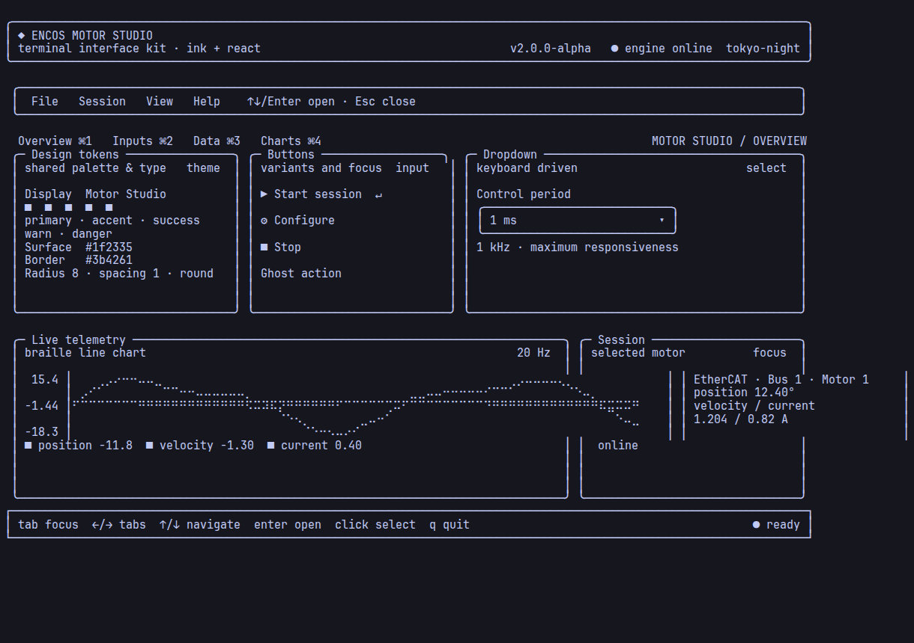
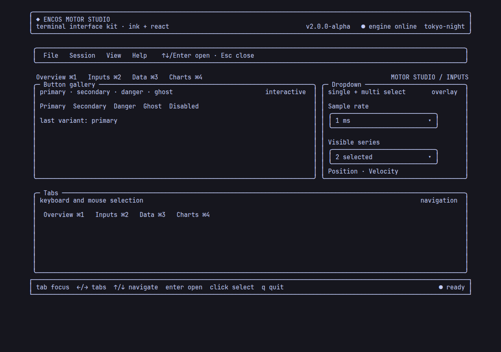
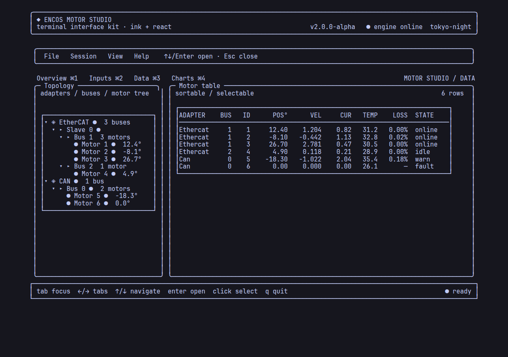
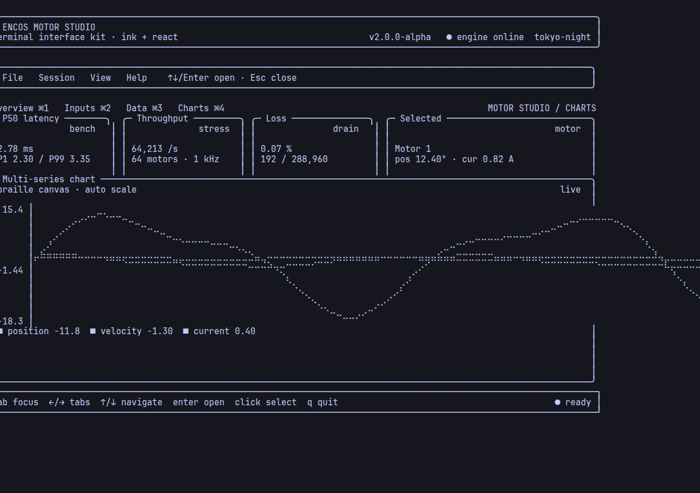

# TUI 基础组件与画廊

基于 **Ink 8 + React 19** 的终端组件库。当前阶段实现基础组件、鼠标点击和可交互画廊，不接入完整 emcli 业务界面；右键菜单暂不实现。

## 设计语言

- 深色 Tokyo Night 风格调色板：`#16161e` 背景、`#c0caf5` 正文、`#7aa2f7` 主色、`#bb9af7` 强调色。
- 圆角边框、1 格内边距、统一 `Card` 表面。
- 信息层级：`muted` 辅助文字、`bold` 主标题、状态色只用于状态点/徽章/图表序列。
- 组件不使用粗重边框；按钮为单行 pill，标签页为单行 pill；不使用左侧竖线、下划线或圆点作为焦点标记。
- 所有组件由同一套 `theme.ts` 驱动，后续换主题只改一处。

## 组件

| 组件 | 文件 | 能力 |
| --- | --- | --- |
| `Card` | `components/Card.tsx` | 标题嵌在上边框、副标题、徽章、footer、统一边框/间距 |
| `Button` | `components/Button.tsx` | primary / secondary / ghost / danger，焦点、Enter/Space、图标、快捷键 |
| `Tabs` | `components/Tabs.tsx` | 激活态主色底色、hover/focus 统一底色，左右方向键切换 |
| `Dropdown` | `components/Dropdown.tsx` | 单选/多选，Enter/Space 展开，↑↓ 选择，Esc 关闭，描述/徽章 |
| `TreeSelect` | `components/TreeSelect.tsx` | 树形单选/多选、方向键展开折叠、最大高度与滚动 |
| `TreeList` | `components/TreeList.tsx` | adapter/slave/bus/motor 层级、展开/折叠、状态点、滚动 |
| `Table` | `components/Table.tsx` | 列宽/对齐、表头、选中行、滚动、自定义取值 |
| `LineChart` | `components/LineChart.tsx` | 多序列、braille 画布、自动 Y 轴、图例、当前值 |
| `MenuBar` | `components/MenuBar.tsx` | File/Session/View 菜单栏，覆盖式下拉，快捷键、勾选项、分隔线、点击/键盘操作 |
| `Badge` | `components/Badge.tsx` | solid / outline / muted |

鼠标层：`apps/emcli/src/tui/mouse.tsx`

- 启用 SGR mouse tracking（`?1000h` + `?1006h`），使用 alternate screen 保证坐标与布局一致。
- 鼠标序列在进入 Ink 前被过滤，避免 ESC 被误判为 Escape 键并重置焦点。
- `MouseRegion` 通过 `measureElement` 做布局命中测试；按钮、Tabs、Dropdown 选项、树行、表格行、菜单项都可点击。
- 鼠标移动开启 `?1003h`，hover 与键盘焦点共用 `colors.hover` 底色；当前激活项使用 `colors.active` 主色底色。
- Dropdown/MenuBar 使用 `OverlayProvider` 绝对定位覆盖内容，不再拉伸父容器。

## 画廊

```bash
pnpm --filter @encos/emcli gallery
```

画廊有四个标签页：

- **Overview**：设计 token、按钮、下拉、实时折线图、选中电机卡片
- **Inputs**：按钮全变体、下拉、Tabs 两种形态
- **Data**：拓扑树 + 电机表格
- **Charts**：性能指标卡片 + 多序列 braille 折线图

键盘：

- `Tab` / `Shift+Tab`：切换焦点；焦点/悬浮使用同一底色，激活项使用主色底色
- `←` / `→`：切换标签页（Tabs 聚焦时）
- `↑` / `↓`：树/表格/下拉/菜单项导航
- `Enter` / `Space`：执行按钮、展开下拉、展开树节点、打开菜单
- `Esc`：关闭下拉/菜单
- 鼠标左键：点击按钮、Tabs、下拉、树行、表格行、菜单栏/菜单项
- 鼠标悬浮：按钮、Tabs、下拉、树行、表格行、菜单项显示 hover 底色
- `1`–`4`：快速切换画廊标签页
- `q`：退出

## 画廊截图

### Overview



### Inputs



### Data



### Charts



## 组件使用示例

```tsx
import { Card, Button, Tabs, Dropdown, TreeList, Table, LineChart } from './tui/index.js'

<Card title="Session" subtitle="selected motor" badge="live">
  <Button label="Start" variant="primary" onPress={start} />
</Card>
```

```tsx
<LineChart
  series={[
    { label: 'position', color: '#7aa2f7', data: position },
    { label: 'velocity', color: '#bb9af7', data: velocity },
  ]}
  width={72}
  height={10}
/>
```

## 后续接入

1. 用 `TelemetryStore` 替换画廊里的静态数据。
2. 把 `TreeList` / `Table` 的选中项接到 `SelectionStore`。
3. 按钮/下拉/Tabs/菜单栏接到 command service。
4. 完整界面采用左树、中表格/标签页、右详情、底部图表的布局。
5. 右键菜单后续与键盘 `Ctrl+Space` 共用同一菜单模型。

## 多选与菜单栏示例

```tsx
<Dropdown
  label="Visible series"
  multiple
  options={[
    { value: 'position', label: 'Position' },
    { value: 'velocity', label: 'Velocity' },
  ]}
  values={series}
  onChange={setSeries}
/>

<MenuBar
  menus={[
    {
      id: 'session',
      label: 'Session',
      items: [
        { id: 'start', label: 'Start', shortcut: '↵', onSelect: start },
        { id: 'stop', label: 'Stop', disabled: !running, onSelect: stop },
      ],
    },
  ]}
/>
```

### 输入框选区复制

鼠标拖选或 Shift＋方向键建立选区后，按 **Ctrl+Shift+C** 或右键复制选中的文本；
Ctrl+A 可全选。复制保留选区，不修改输入值；密码输入框不复制内容。
Ctrl+C 仍用于退出 Gallery。

复制通过终端 OSC 52 写入系统剪贴板，要求终端支持并允许该操作。
终端自带的 Ctrl+Shift+C 通常复制的是终端选区，并不会把按键交给应用，
需要将该组合键透传为 CSI-u 序列 `ESC [ 99 ; 6 u`。例如 Kitty 的配置为：

```conf
map ctrl+shift+c send_text all \e[99;6u
```

该映射会将终端原来的复制快捷键交给应用；不透传时，仍可使用终端自己的文本选择与复制。
自定义 Ink 宿主应设置 `exitOnCtrlC: false` 并像 Gallery 一样自行处理不带 Shift 的 Ctrl+C，
避免 Ink 把 Ctrl+Shift+C 也当成退出。

参考：[Kitty 按键映射](https://sw.kovidgoyal.net/kitty/conf/#send-arbitrary-text-on-key-presses)、
[OSC 52 剪贴板协议](https://iterm2.com/3.4/documentation-escape-codes.html#copy-to-clipboard)。

### 滑条与输入框组合精度

`SliderInput` 支持 `precision`（0–10 位小数）和 `step`（滑动/方向键步长）：

```tsx
<SliderInput value={speed} onChange={setSpeed}
  min={0} max={100} precision={2} step={0.05} />
```

设置 `precision={2}` 后，数值回调保留两位小数，提交、失焦和拖动后显示固定两位小数。
输入过程中保留原始草稿（如 `1.`、`1.230`），有效数值实时映射到滑条。
未设置 `step` 时默认步长为 `10 ** -precision`；设置 `step` 时先按步长对齐，再按精度舍入。
边界限制优先于精度，建议 min/max 和 step 使用该精度可表示的数值。
省略 `precision` 则保留可变小数位和原有默认步长 0.1。

### LogCard

`LogCard` 显示英文标题、空状态、计数和操作提示；日志正文保留来源内容，不做翻译。
日志存储与展示独立，第一版不接入 native 捕获。

```tsx
const store = createLogStore({ maxEntries: 5000, flushIntervalMs: 50 })

store.append({ source: 'driver', stream: 'stdout', level: 'info',
  message: 'Adapter connected' })

<LogCard store={store} title="Driver logs" height={14}
  levels={['warn', 'error', 'fatal']} showTimestamp showSource />

// Release timers and subscriptions when the owner exits.
store.dispose()
```

- `LogInput`：`message` 必填；`timestamp`、`level`、`source`、`stream` 可选。
  级别为 trace/debug/info/warn/error/fatal/unknown，默认 unknown；stderr 不等于 error。
- `LogEntry`：增加 store 生成的递增 `id` 与毫秒级 `receivedAt`，记录和快照均只读。
- Store 支持 `append`、`appendMany`、`clear`、`dispose`；
  `getSnapshot` 与 `subscribe` 可供其他视图通过 useSyncExternalStore 订阅。
  默认每 50ms 批量通知，容量为 5000 条，待刷新记录也受容量限制。
  `clear` 立即清除已发布和待发布记录，dispose 后不再接受追加。
- 布局支持 `width`、`height`、`flexGrow`；独立使用默认高度 14。
  `autoFocus` 控制初始焦点。
- 筛选 props：`levels`、`sources` 和 `query`。query 对正文做不区分大小写的字面匹配。
- `showTimestamp`、`showSource`、`wrap` 默认 true。
  多行消息按记录管理，续行与正文对齐；wrap=false 时按可见宽度截断，复制仍包含完整正文。
- `follow`/`onFollowChange` 支持受控跟随，非受控模式使用 `defaultFollow`（默认 true）。
  向上滚动查看历史会暂停跟随，追加日志不会移动历史位置；翻页、滚轮或拖动滚动条回到底部自动恢复跟随。
  历史按 ID 锚定，锚点被淘汰时回到剩余最旧记录。
- 方向键按记录导航；PageUp/PageDown 翻页；Home 到顶部；日志卡片不绑定 End。
  Shift＋方向键、Shift＋Home 或鼠标拖动选择记录范围。
- Ctrl+Shift+C 复制选区，无选区时复制当前记录；右键优先复制选区，无选区时复制所点记录。默认通过 OSC 52 输出，
  沿用上文终端透传要求；`onCopy(entries)` 可接管复制并返回 Promise，完成后通知成功，抛错或拒绝时通知失败。
- 入库时清除 ANSI/OSC 和其他终端控制字符。日志按接收顺序追加，不根据时间戳重新排序。
- Gallery 新增 Logs 页：级别筛选、正文搜索、Add log、Add 100、Clear。

`Card` 增加 `scrollable={false}`，用于 LogCard 这类自行管理可见行和滚动条的组件；
普通 Card 默认仍使用原来的自动滚动容器。


复制通知由 NotificationProvider 提供，所有文案为英文。OSC 52 不返回成功确认，
默认提示 “Copy request sent to terminal”；自定义复制回调完成后提示 “Copied to clipboard”，
失败时提示 “Could not copy to clipboard”。输入框右键保留选区和光标，无选区或密码输入框不复制。
终端需将右键事件交给应用；若终端自身拦截右键菜单，应用无法收到该事件。

### 菜单最大高度与滚动导航

Dropdown 和 MenuBar 的 `maxHeight` 默认为 12，单位为终端行，包含上下两行边框，
最小为 3。MenuBarMenu 也可设置 maxHeight，覆盖菜单栏统一配置。
实际高度同时受终端可用高度限制，并随终端 resize 更新。

```tsx
<Dropdown maxHeight={8} label="Options" options={options}
  value={value} onChange={setValue} />

<MenuBar maxHeight={12} menus={[
  { id: 'file', label: 'File', maxHeight: 8, items: fileItems },
]} />
```

超出可见高度后显示滚动条，支持滚轮、点击滚动条轨道、拖动滑块、
PageUp/PageDown 和 Home/End。菜单栏键盘导航跳过禁用项和分隔线，
选项移动到视口外时自动滚动显示；滚动后的点击坐标映射到正确的原始选项。
多选下拉框勾选后保持当前选项位置。

方向焦点导航优先遍历当前滚动区域中的控件（包含被裁剪的控件），由容器自动滚动显示；
到达该方向真正的边界后才离开区域。方向键连续重复事件按顺序处理，
Tab/Shift+Tab 沿用 Ink 的连续焦点遍历，松开按键事件不会额外移动焦点。
长按重复频率由终端/操作系统决定，不额外启动无法在旧终端可靠停止的重复计时器。

### 实时 LineChart

LineChart 支持两种实时数据接口：

1. 通过 `series` 传入不可变数组，数据项为 `{ timestamp, value }`，timestamp 是 Unix 毫秒时间戳。
2. 使用 `createChartStore` 在 React 外部注入数据，组件通过订阅批量更新。

```tsx
const chart = createChartStore({
  series: [
    { id: 'position', label: 'Position', color: '#0178d4' },
    { id: 'current', label: 'Current', color: '#54c7ec' },
  ],
  retentionMs: 10000,
  maxPointsPerSeries: 10000,
  flushIntervalMs: 50,
})

// Native callbacks, IPC handlers or other data sources can write to this store.
chart.append('position', 12.4) // Timestamp defaults to Date.now().
chart.appendMany([
  { seriesId: 'position', timestamp: Date.now(), value: 12.5 },
  { seriesId: 'current', timestamp: Date.now(), value: 0.82 },
])

<Box height={24} flexDirection="column">
  <Text>Telemetry</Text>
  <Card title="Live telemetry" scrollable={false}>
    <LineChart store={chart} windowMs={10000} />
  </Card>
</Box>

// Call when the data source owner exits.
chart.dispose()
```

- 默认 X 轴显示当前时刻之前 10000ms，按真实时间间距定位采样点，不按采样数量平均铺开。
  未收到新数据时仍移动窗口；时间窗口外和未来的采样不参与当前显示和自动缩放。
- 默认 Y 轴按可见窗口内所有曲线的有限数值自动缩放，保留边距。
  常量值有非零范围；单个点也会绘制；NaN/Infinity 表示曲线断点。
  `yMin`/`yMax` 可指定固定边界。
- `width`/`height` 可省略，图表占满有明确尺寸的父容器剩余空间。
  Card 中使用 `scrollable={false}`，避免滚动内容容器的无界高度阻止自动填充。
  标题、时间刻度和图例均计入图表自身高度。
- `showLegend`、`showAxis` 默认 true；`title` 可选。
  `refreshIntervalMs` 默认 50ms，用于窗口时钟刷新；传入 `now` 可控制回放时间并关闭内部时钟。
- 旧的 `number[]` 数据接口继续支持，按数组索引绘制；要使用 10 秒时间窗口，应提供时间戳或 store。
  同时传入 store 和 series 时使用 store。
- Store 支持 append、appendMany、clear、dispose、subscribe 和 getSnapshot。
  默认保留 10 秒、每条曲线最多 10000 点，每 50ms 通知一次；更新时排序并淘汰旧数据，
  待刷新队列也有容量限制。长时间没有数据时展示会自然清空，缓存于后续追加时清理或由 clear/dispose 清空。
  若扩大 windowMs，也应相应扩大 retentionMs。
- 高密度数据按绘图像素列保留极值和端点，避免仅按固定间隔抽样丢掉尖峰。
- Overview 与 Charts 页面使用 20 Hz 模拟数据验证实时效果，尚未接入 driver native。

### Axis ticks, drag scrolling, and terminal cleanup

`LineChart` chooses tick intervals from 1/2/2.5/5 × powers of ten based on its available width and height. Timestamped series use relative seconds within `windowMs`; legacy numeric arrays use sample indices. Y ticks follow the visible data range, while explicit `yMin`/`yMax` remain exact.

Dragging a selection above or below `LogCard` continuously scrolls and extends the selection, even while the pointer remains stationary. Returning inside the viewport, releasing the button, losing focus, or opening a modal stops automatic scrolling.

The gallery uses Ink's `render({ alternateScreen: true })` lifecycle so entering happens before the first frame and restoring the original terminal buffer happens after the last frame and component cleanup. Piped output remains normal noninteractive output.

### Stable wrapping legends and multiple Y axes

Legends use equal-width cells based on series names, with a fixed value field. Updating values never changes cell positions or row count. `legendItemWidth` optionally sets the cell width in terminal columns; terminal resizing recalculates wrapping. Legend rows consume space inside the chart, leaving the plot to fill the remainder. When the container cannot accommodate all legend rows and a minimal plot, an English overflow hint requests more space.

Bind each series (including `createChartStore` definitions) using `yAxisId`:

```tsx
const store = createChartStore({ series: [
  { id: 'position', label: 'Position', color: '#0178d4', yAxisId: 'position' },
  { id: 'current', label: 'Current', color: '#43c5e6', yAxisId: 'current' },
] })
<LineChart store={store} yAxes={[
  { id: 'position', label: 'Pos (deg)', position: 'left', color: '#0178d4' },
  { id: 'current', label: 'Cur (A)', position: 'right', color: '#43c5e6', min: 0 },
]} />
```

`ChartYAxis` exposes `id`, `label`, `position` (`left` by default), `color`, `min`, and `max`. Multiple axes may occupy either side; each independently scales and generates ticks from its bound series within the visible time window. Explicit bounds override automatic bounds. Unbound series use the first configured axis; legacy `yMin`/`yMax` apply to that axis. Without `yAxes`, axes are inferred from series bindings (or a single default axis), with the first on the left and others on the right. Duplicate axis IDs and unknown explicit bindings are errors. `showAxis={false}` hides axes without changing independent scaling.

The Charts gallery now demonstrates 30 series with three Y axes and a wrapping legend. On terminals shorter than 38 rows, summary cards are hidden to prioritize the chart.

### Notification details and hover timeout

A notification whose message exceeds the one-line preview (including multiline messages) displays an `Expand` button. It opens a bounded, scrollable full-text dialog; `Close` or Escape returns to the notification. Reading the full text pauses expiry and blocks background controls, including an already-open dialog. Hovering anywhere on a notification, including its buttons, pauses the remaining timeout; leaving resumes that remaining duration. `timeout: 0` remains persistent.


### ContextMenu 与折叠卡片

`ContextMenu` 包裹任意组件，保留子组件左键操作，右键在包裹区域下方显示菜单（靠近窗口边缘时自动限位）。支持 `Ctrl+Space`、方向键、Enter、Esc、滚轮以及 `maxHeight`。

```tsx
<ContextMenu items={[
  { id: 'canfd', label: 'CAN FD', checked: canfd, onSelect: toggleCanFd },
  { id: 'delete', label: 'Delete', onSelect: removeDevice },
]}>
  <Text>Motor 57 0x39</Text>
</ContextMenu>

<Card title="Details" collapsible defaultCollapsed={false}>...</Card>
<LogCard store={logs} title="Logs" collapsible collapsed={collapsed}
  onCollapsedChange={setCollapsed} height={10} />
```

复合控件可通过 `keyboardActive` 指定当前行是否接收快捷键，`restoreFocusId` 指定关闭后的焦点，`onOpen` 同步选中目标。菜单项目沿用 `MenuBarItem`，支持禁用、勾选、分隔线；弹出层按所有者关闭，其他组件的卸载不会误关当前菜单。

`Card` / `LogCard` 支持 `collapsible`、`collapsed`、`defaultCollapsed`、`onCollapsedChange`。折叠时仅占铺满宽度的一行，隐藏内容不接收输入；日志数据仍继续积累。树可用 `borderless compact` 填满 Card，移除内部边框、类型图标与叶节点展开占位；`value` 控制选择，`contextMenu(node)` 提供节点菜单。


`Footer` 的 `hints` 接收只展示的快捷键提示，`ctrl+` 在显示时统一转换为 `^`，内部快捷键匹配规则不变。`MenuBarItem.separator` 显示分隔线，鼠标与键盘均不可激活分隔线。

`LoadingOverlay({label})` 使用居中浮框显示动态 `Spinner` 和操作名称，作为 `DialogHost` 的 `dialog` 可阻止背景交互；卸载会清理动画定时器。

### TwoColumns

`<TwoColumns minColumnWidth={44} gap={2} fallbackWidth={80}>…</TwoColumns>` 根据父容器实际宽度排列子组件；宽度不足 `2 * minColumnWidth + gap` 时自动回退单栏，保持源码顺序与子组件状态。`useColumnWidth()` 返回当前栏宽，供表格或输入组件适配。`fallbackWidth` 仅用于首次测量之前的布局。`rowGap` 可独立设置纵向间距，默认一行，与横向 `gap` 独立；Timing 表单使用 `rowGap={0}`。

### Initial focus and medium buttons

- Dialog 聚焦第一个启用的内容控件；没有输入控件时聚焦 Cancel / Close。关闭恢复触发控件，嵌套通知关闭后恢复原字段。LoadingOverlay 同样恢复触发控件，autoFocus 控件只在确实没有可用焦点时恢复，不改动 Tab 注册顺序。
- Button 支持 `size="small" | "medium" | "large"`。medium 占三行布局，上行为下半色块 `▄`，中行为文字，下行为上半色块 `▀`；视觉高度两行，文字与三行输入框/下拉框的值行对齐。同行带标签的三行字段采用底部对齐，使按钮与字段本体的中心一致。


### TreeSelect

`nodes` 使用全树唯一的 `value`、`label` 和可选 `children`。分支默认只展开，叶子默认可选；
`selectable` 可覆盖默认行为，`disabled` 会禁用整个子树。`width` 默认 48，`maxHeight` 默认 12（包含边框）。

```tsx
<TreeSelect label="Bus" nodes={nodes} value={bus} onChange={setBus} maxHeight={12} />
<TreeSelect label="Devices" nodes={nodes} multiple values={devices} onChange={setDevices} />
```

Enter 打开，↑↓ 移动，←→ 折叠/展开，Enter 或 Space 选择。单选确认后收起；多选保留当前光标和展开状态。
PageUp/PageDown、Home/End 及鼠标滚轮支持长列表；Esc 先关闭下拉层，再次 Esc 才关闭外层对话框。
单选收起时显示完整路径（空间不足时保留末尾），多选显示选中数量。

多选可设置 `cascade`，并将分支节点的 `selectable` 设为 `true`：点击分支文字/复选框或按 Space/Enter 会批量选择可选后代叶子，已全选时清空。半选显示 `[−]`，禁用叶子不参与批量操作，返回值只包含叶子的 value。三角仍用于展开/折叠。


TreeList 可通过 `checkedIds` 与 `onToggle` 使用多选样式。该模式中方向键只移动游标，左键或 Space/Enter 切换选中；右键菜单只移动游标，不触发勾选。Ctrl+Space 不会同时触发子组件的普通 Space 操作。

TreeList 多选父节点显示全选/半选状态，文字/复选框点击或 Space 调用 onToggle，三角点击或 Enter 仅展开折叠。`toggleTreeSelection(node, checkedIds)` 对全部后代叶子（包括折叠内容）切换选择，并保留其他分支的选项。

### Interactive chart legend

Legend entries toggle their series on left click or Enter / Space when focused. Hidden entries stay in their original cells, use a muted hollow square, and keep receiving data. They are excluded from plotting and automatic Y ranges. Series identity uses `id`, falling back to `label`; use unique stable IDs for dynamic collections.

`hiddenSeriesIds?: readonly string[]` and `onHiddenSeriesChange?: (ids: string[]) => void` provide controlled visibility. Without `hiddenSeriesIds`, visibility is managed inside the chart. All series start visible. Existing legend wrapping and fixed value widths remain unchanged.

### Checkbox and FilePicker

`Checkbox` accepts `label`, controlled `checked`, `onChange`, and optional `disabled`. Mouse click, Enter and Space toggle it using the existing focus and modal blocking system.

`FilePicker` is a modal with `initialPath`, asynchronous `list(path)`, `onSelect(path)` and `onClose`. Its listing contract contains `path`, `parent` and entries (`name`, `path`, `directory`). The listing provider decides filtering; Play lists folders and CSV files. Enter opens the selected folder or chooses its file, and the dialog also supplies path, Go, Parent folder and Select controls.

`Table` supports `onActivate`, `viewportWidth` with horizontal scrolling, and `onSort(columnIndex)` / `sortColumn` / `sortAscending` for focusable column headers. Click or Enter sorts; Tab retains normal focus traversal. `autoColumns` sizes columns from terminal-width headers and data, reserving space for the sort indicator. The supplied `height` is a maximum: no empty trailing rows are rendered. `MenuBarMenu.disabled` prevents opening a disabled menu. Footer actions wrap when needed.

- Table cells are fitted by terminal display width at grapheme boundaries, so CJK and emoji occupy one row. `onRowClick` is distinct from keyboard selection and activation. `selectionKey` resets selection and scroll on a dataset change while retaining the mounted table and its focus.
